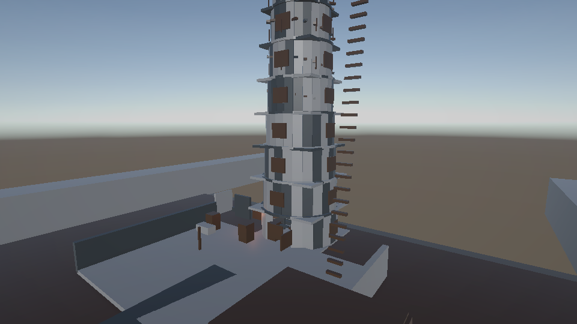
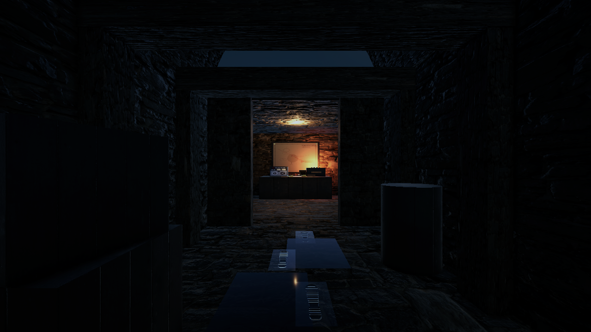
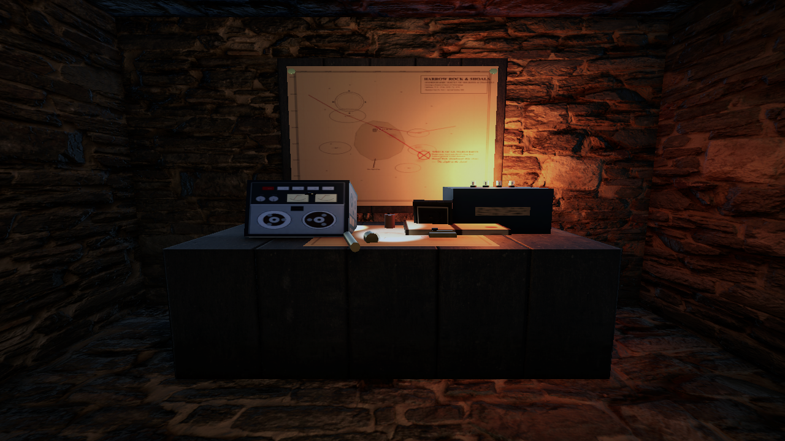
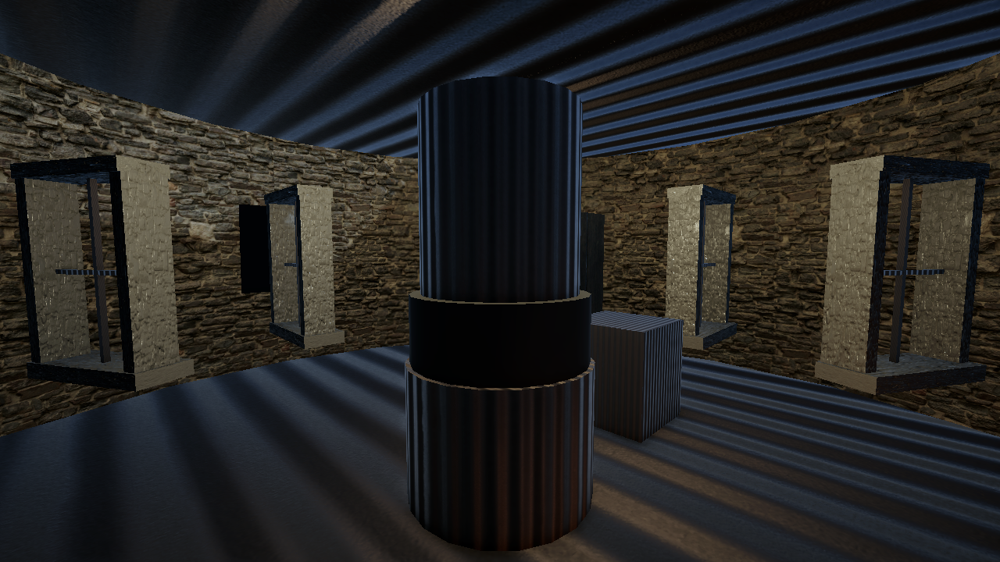
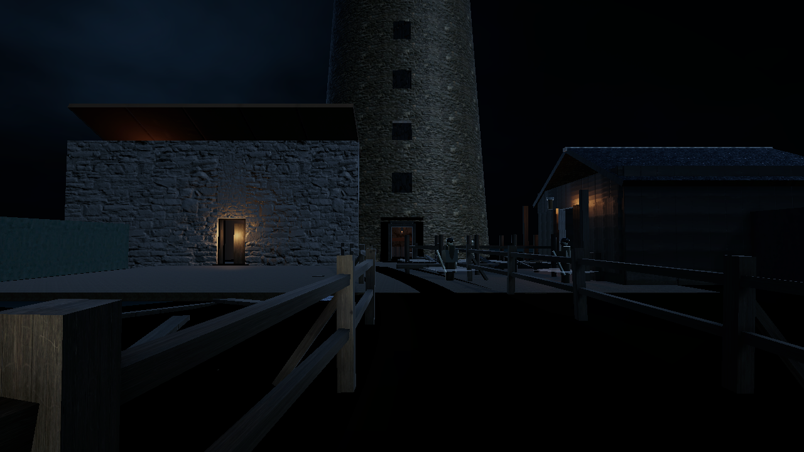
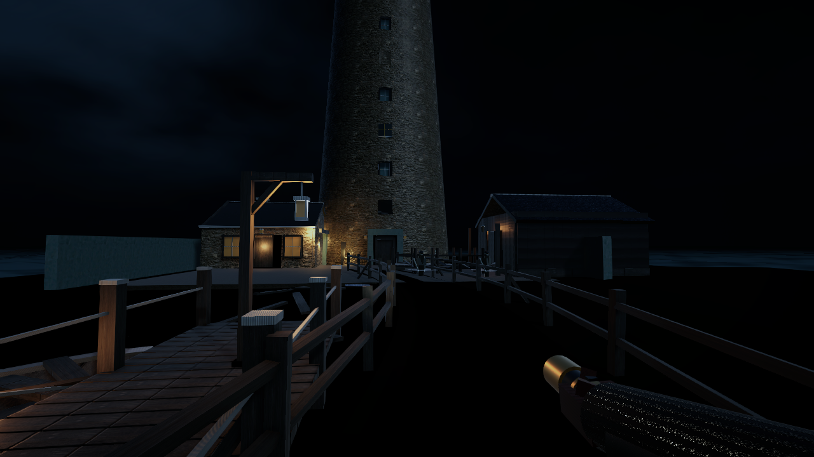

# 🌊 The LightHouse

[](https://unity.com/)
[](https://openjdk.org/)
[](https://spring.io/projects/spring-boot)
[](https://www.postgresql.org/)
[-lightgrey?logo=apple&style=flat-square)](docs/performance-budget.md)
[](CREDITS.md)

> *"Daniel, light the lamp before dusk, and never answer any singing."*

**The LightHouse** is a first-person atmospheric psychological horror game set on the wave-scoured isolation of **Harrow Rock**. Players assume the role of **Daniel Hale**, a guilt-ridden former sailor who abandoned six crewmates in a storm, sent to relieve keeper **Thomas Crane** after three weeks of radio silence. 

Upon arrival, Daniel discovers that the lighthouse beacon is not an aid for navigation—it is an **occult leash** holding back **The Drowned** lurking in the shallows. When the island generator drowns in a vicious squall, Daniel must manually hand-crank the Fresnel lamp to hold back the encroaching figures, knowing each grinding revolution broadcasts his location to an acoustic predator hunting him in the dark.

---

## 📸 Atmosphere & Environments

| Exterior & Tower Catwalk | Subterranean Vault Corridor | Hidden Reel-to-Reel Bunker |
| :---: | :---: | :---: |
|  |  |  |
| **Lantern Gallery & Pedestal** | **Dock Arrival Point** | **First-Person Immersion** |
|  |  |  |

---

## 🎮 Core Gameplay Systems

### 🔊 1. Acoustic Stealth & Sound-Hunting Stalker AI (`StalkerAI`)
- **Blind Acoustic Predator**: The drowned keeper stalks Daniel strictly through acoustic propagation rather than visual cones.
- **Dynamic Surface Acoustics**: Footstep noise scales with surface types (stone flagstones, wooden planks, shallow water, mud) and movement phases.
- **Noise Budget vs. Stealth**: Sprinting, hard vertical landings, opening heavy iron doors, and hand-cranking emit radial sound spheres.
- **Survival Maneuvers**: Breath-holding hiding spots, door barricades, and auditory masking during thunderstorm lightning strikes.

### 👁️ 2. The Drowned: Sight & Illumination Mechanics (`DrownedManager`)
- **Vision-Locked Entities**: Shallows and courtyard figures freeze motionless while kept in direct player line-of-sight or bathed in the Fresnel lamp beam.
- **Encroaching Darkness**: When Daniel looks away or the beacon extinguishes, figures advance silently, tightening an inescapable perimeter.
- **Light Pulses**: Sustained beacon charge unleashes high-intensity light pulses that repel unobserved figures across the courtyard.

### ⚙️ 3. Hand-Crank Dynamo & Lamp Physics (`LampController`)
- **Failing Beacon Loop**: Fuel drainage and flooded generators force physical interaction with the lantern room crank station.
- **Mechanical Dilemma**: Operating the manual crank charges the lamp and holds back the Drowned—but each turn generates loud acoustic events that pull the stalker up the spiral stairs.
- **Fresnel Lens Mechanics**: Charge level governs light intensity, rotation cadence, fog penetration, and occult barrier effectiveness.

### 🔦 4. First-Person Flashlight & Hand Viewmodel (`TorchViewmodel`, `FlashlightController`)
- **Authentic 1940s Hardware**: Ribbed cylindrical brass/iron torch with textured hand grip, glass lens emitter, and realistic viewmodel sway.
- **Accurate Optical Projection**: Spot Light anchored precisely to the front lens barrel (`(0, 0, 0.075)`), illuminating the environment forward without clipping or glowing inside the character's hands.
- **Light Layer Separation**: Layer-based rendering isolates the first-person viewmodel and arms from harsh spotlight casting while maintaining realistic environmental beam throw.
- **Atmospheric Audio Integration**: Dedicated foley effects for rotary switch clicks (`Switch_On`, `Switch_Off`), subtle filament hum, electrical sparks, and wet wool coat rustling.

### 🎙️ 5. Decoupled Voice Architecture & Spatial Audio (`VoiceManager`)
- **6-Channel Dynamic Ducking**: Priority-driven audio routing balancing player vocalizations, radio communications, and monster respirations.
- **Analog Authenticity**: Voice lines utilize realistic bandpass filters, room reverb zones (cavernous cellar stone, glass gallery), and tape-flutter distortions.
- **Marta's Secret**: Radio interactions maintain audio continuity with the antique reel-to-reel magnetic tape transmitter hidden deep in the cellar vaults.

### 🏰 6. Modular Interior & Subterranean Architecture
- **Metric 0.5m Architecture**: Complete 8-tier tapered stone lighthouse tower, continuous ramp spiral stairways, living quarters, study watchroom, and lantern chamber.
- **Zero-Light-Leak Joint Repairs**: Procedural annular joint meshes and double-sided masonry culling (`_Cull: 0`) ensure seamless connections between outer round masonry and inner rectangular rooms.
- **Weathered Window Enclosures**: Tower window embrasures feature solid dark-glazed glass panes (`Cold Window.mat`), stone reveals, and iron mullions (`TowerWindowEnclosure`), preventing hollow see-through artifacts.
- **Triplanar Coastal Terrain (`TheLightHouse/CoastalIsland.shader`)**: Clustered URP Forward+ multi-compile, high-res coastal mud PBR maps, wet tide height gradations, and nighttime ambient reflection floors.
- **Subterranean Vault**: 20-meter vaulted corridor lined with damp masonry, wet footprints with no return trail, and a concealed bunker behind sliding storage barrels.

---

## 📖 Story Progression (Acts 1–5)

The game executes a seamless 5-act narrative verified through strict event contracts (`docs/story-beats.md`):

| Act | Title | Core Setting | Narrative Beat & Mechanical Climax |
| :--- | :--- | :--- | :--- |
| **Act 1** | *Arrival* | Harrow Rock Dock & Tower Ground Floor | Daniel lands at dusk; receives the boatman's warning; inspects a warm meal; hears Marta's radio greeting; ignites first light before dark. |
| **Act 2** | *Cellar & Stalker* | Subterranean Storerooms & Shallows | Beacon fuel runs low; cellar humming shanty heard; unreturned wet footprints found; acoustic stalker awakens; weeping figures appear in shallows. |
| **Act 3** | *Storm & Crank* | Lantern Room & Spiral Stairs | Squall drowns island generator; manual hand-cranking begins; loud gear grinding versus advancing dark; Crane climbs the stairs. |
| **Act 4** | *Truth* | Hidden Radio Room & Crane's Quarters | Logbooks reveal the *Marguerite* shipwreck was intentional; Marta is an analog tape loop; ledger reveals Daniel was chosen for his guilt; Crane is Daniel's father. |
| **Act 5** | *Dawn* | Flooded Courtyard & Dock | The courtyard floods with Drowned; Daniel holds the failing light; Crane draws the horde away while singing the lullaby; dawn breaks; morning boat escape. |

---

## 🏗️ System Architecture & Dual-Mode Pipeline

The project features a **Client-Server Architecture with Offline-First Fallback**, ensuring the full single-player game runs completely standalone while supporting optional cloud persistence, world director synchronizations, and live telemetry when connected to the backend.

```
 ┌────────────────────────────────────────────────────────────────────────┐
 │                      Unity 6 Client (URP / C#)                         │
 │                                                                        │
 │  ┌───────────────────────┐              ┌───────────────────────────┐  │
 │  │ FirstPersonController │              │  StalkerAI & DrownedMgr   │  │
 │  └──────────┬────────────┘              └─────────────┬─────────────┘  │
 │             │ Player Noise                            │ World Events   │
 │             ▼                                         ▼                │
 │  ┌───────────────────────┐              ┌───────────────────────────┐  │
 │  │    NoiseEmitter       │              │      StoryDirector        │  │
 │  └──────────┬────────────┘              └─────────────┬─────────────┘  │
 │             │                                         │                │
 │             ▼                                         ▼                │
 │  ┌──────────────────────────────────────────────────────────────────┐  │
 │  │               ServerEventBridge & NetworkClient                  │  │
 │  │      (Offline Fallback Active: Local Gameplay Simulation)        │  │
 │  └──────────────────────────────┬───────────────────────────────────┘  │
 └─────────────────────────────────┼──────────────────────────────────────┘
                                   │
              WebSocket JSON / REST│ (Bearer JWT / Offline-First)
                                   ▼
 ┌────────────────────────────────────────────────────────────────────────┐
 │                   Spring Boot 3.4.5 Backend (Java 21)                  │
 │                                                                        │
 │  ┌──────────────────────────────┐       ┌───────────────────────────┐  │
 │  │    GameWebSocketHandler      │       │     SessionRegistry       │  │
 │  │  {type, seq, payload}        │──────▶│      (1 Hz World Tick)    │  │
 │  └──────────────────────────────┘       └─────────────┬─────────────┘  │
 │                                                       ▼                │
 │  ┌──────────────────────────────┐       ┌───────────────────────────┐  │
 │  │    CloudSaveController       │       │       WorldDirector       │  │
 │  │    (/save, /runs, /auth)     │       │ (Storm & Adaptive Tension)│  │
 │  └──────────────┬───────────────┘       └───────────────────────────┘  │
 └─────────────────┼──────────────────────────────────────────────────────┘
                   │
                   ▼
 ┌────────────────────────────────────────────────────────────────────────┐
 │             PostgreSQL 16 Database (Flyway Migrations)                 │
 └────────────────────────────────────────────────────────────────────────┘
```

---

## 🎯 Target Hardware & Performance Budget

Optimized for **Apple Silicon (MacBook Air M3, 8 GB Unified CPU/GPU RAM)** under strict memory and rendering budgets:

- **Unified Memory Budget**: Client assets, textures, and runtime memory are capped strictly under **8 GB** total footprint.
- **Rendering Pipeline**: Universal Render Pipeline (URP) with tailored Mac & Low quality tiers.
- **Lighting Limits**: $\le 4$ real-time light sources per scene; static baked GI combined with optimized reflection probes.
- **Geometry & Textures**: 1K PBR packed Metallic-Smoothness maps, triplanar rock shaders, beveled props $\le 2000$ tris.
- **In-Engine Profiling**: Automated verification with `TheLightHouse/Check Asset Budget` and real-time `F4` memory overlay.

---

## ⌨️ Controls & Input Mapping

Built natively with **Unity's New Input System**:

| Input | Action | Description |
| :--- | :--- | :--- |
| <kbd>W</kbd> <kbd>A</kbd> <kbd>S</kbd> <kbd>D</kbd> | **Movement** | First-person ground locomotion with surface-dependent acoustics. |
| <kbd>Mouse</kbd> | **Look** | Smooth first-person camera rotation and entity line-of-sight tracking. |
| <kbd>Left Shift</kbd> | **Sprint** | High-speed dash governed by stamina; emits elevated acoustic signature. |
| <kbd>C</kbd> *(Hold)* | **Crouch** | Lowers capsule clearance for crawlspaces; reduces acoustic emissions. |
| <kbd>Space</kbd> | **Jump / Skip** | Vertical ledge vaulting; impact generates landing noise. Skips active dialogue lines. |
| <kbd>Z</kbd> / <kbd>X</kbd> | **Lean Left / Right** | Corner peeking without exposing character collision capsule. |
| <kbd>E</kbd> | **Interact / Skip** | Operate doors, read logbook pages, crank dynamo, handle fuel cans. Skips dialogue. |
| <kbd>1</kbd> | **Equip / Holster** | Toggles first-person handheld pocket torch viewmodel. |
| <kbd>F</kbd> | **Toggle Light** | Switches torch beam on/off with authentic rotary switch click audio. |
| <kbd>Esc</kbd> | **Journal / Pause** | Access discovered lore fragments, objectives, and audio mixer controls. |
| <kbd>F3</kbd> | **Diagnostics** | Real-time movement speed, grounding probe, noise radius, and stamina HUD. |
| <kbd>F4</kbd> | **Budget Overlay** | Live VRAM, texture memory, draw call counts, and performance meters. |

---

## 🚀 Quick Start Guide

### Prerequisites
- **macOS** with [Unity 6 (6000.6.6f1)](ProjectSettings/ProjectVersion.txt)
- **Java 21 LTS** & **Maven 3.9+**
- **Docker Desktop** (with Docker Compose)

---

### Step 1: Run the Backend & Database

```bash
# 1. Start PostgreSQL 16 on port 5433
docker compose up -d --wait postgres

# 2. Run automated server test suite
cd server
mvn test

# 3. Launch Spring Boot application
mvn spring-boot:run
```

*The server will start listening at `http://localhost:8080` (WebSocket endpoint: `ws://localhost:8080/ws`).*

---

### Step 2: Launch the Unity Client

1. Open the repository root in **Unity 6000.6.6f1**.
2. Open the main starting scene: `Assets/_Project/Scenes/Act1.unity`.
3. Locate `NetworkConfig` in `Assets/_Project/Resources/NetworkConfig.asset`:
   - Set Server URL to `http://localhost:8080` and WS URL to `ws://localhost:8080/ws`.
   - Ensure `offlineFallback` is checked (enables seamless local gameplay if server is down).
4. Press **Play** in the Unity Editor.

---

### Step 3: Run the Bot Client & High-Concurrency Load Test

An autonomous bot client simulates real-world player sessions over WebSockets, validating thread safety, session ticking, and database throughput:

```bash
# Execute standalone bot load run (10 bots, 30s duration)
cd bot-client
mvn package
java -cp target/lighthouse-bot-client-0.1.0.jar com.thelighthouse.bot.BotClient \
  --url http://localhost:8080 --bots 10 --duration 30 --ramp-up 5

# Or run the automated multi-tier benchmark (10 to 500 bots)
DURATION_SECONDS=10 RAMP_SECONDS=2 scripts/load-test.sh
```

*Measured benchmark logs and CSV results are saved to [`docs/load-test/`](docs/load-test.md).*

---

## 📡 Backend API & WebSocket Contracts

### REST Endpoints (`http://localhost:8080`)
Detailed specifications available in [`docs/rest-endpoints.md`](docs/rest-endpoints.md).

| Method | Endpoint | Auth | Purpose |
| :--- | :--- | :--- | :--- |
| `POST` | `/auth/register` | None | Register keeper credentials (`username`, `password`) $\rightarrow$ JWT. |
| `POST` | `/auth/login` | None | Authenticate credentials $\rightarrow$ Bearer JWT token. |
| `GET` | `/save` | Bearer JWT | Fetch active game state JSON with optimistic lock version. |
| `PUT` | `/save` | Bearer JWT | Persist game state with optimistic lock validation (`409` on conflict). |
| `GET` | `/runs` | Bearer JWT | Retrieve player survival run history and metrics. |
| `POST` | `/runs` | Bearer JWT | Submit completed or deceased run record (`act`, `duration`, `outcome`). |
| `GET` | `/actuator/health` | None | Service liveness and PostgreSQL database connectivity check. |
| `GET` | `/actuator/prometheus` | None | Real-time Micrometer metrics for Prometheus scraping. |
| `GET` | `/admin/stats` | Admin Token | Aggregated active session, storm pressure, and message throughput metrics. |

### WebSocket Envelopes (`ws://localhost:8080/ws?token=<JWT>`)
Detailed specifications available in [`docs/websocket-messages.md`](docs/websocket-messages.md).

```json
{
  "type": "STORM_STATE",
  "seq": 14,
  "payload": { "intensity": 0.75, "thunderIn": 0.25 }
}
```

- **Client $\rightarrow$ Server**: `NOISE_EMITTED`, `PLAYER_HID`, `LAMP_STATE`, `BEAT_REACHED`, `CHECKPOINT`, `PING`.
- **Server $\rightarrow$ Client**: `STORM_STATE`, `PRESSURE_DELTA`, `RADIO_MESSAGE`, `STORY_BEAT`, `CHECKPOINT_SAVED`, `PONG`.

---

## 🛠️ Verification & Automated Test Suites

The codebase includes comprehensive editor-time and automated runtime validation suites:

- **Interior Architecture Validation**:
  Execute `TheLightHouse -> Validate Interior Kit` or run `InteriorValidation.cs` to test 8 structural checks (stair headroom $\ge 2.4\text{ m}$, continuous ramp colliders $\approx 32^\circ$, hiding spot tags, NavMesh baking, and logbook page anchors).
- **Voice System Validation**:
  Execute `TheLightHouse -> Voice -> Validate Voice Database` to verify clip assignments, ID uniqueness, Marta tape loop continuity, zero audio clipping, and streaming Vorbis import settings.
- **Asset Budget Validator**:
  Execute `TheLightHouse -> Check Asset Budget` to assert zero memory budget violations across textures, models, audio, and materials.
- **Pocket Torch & Viewmodel Play Mode Checks**:
  Execute `TheLightHouse -> Checks -> Pocket Torch (Play Mode)` (`TorchPlaymodeChecks.cs`) during Play Mode to assert 14 runtime invariants: toggle cycles, FOV scaling immunity, sound effect triggers, forward beam vector alignment, and viewmodel rendering layers.
- **Server Concurrency Suite**:
  Run `mvn test` in `/server` to verify JPA optimistic locking, session queue bounds, JWT validation, and WebSocket state transitions.

---

## 📁 Repository Structure

```
The LightHouse/
├── Assets/_Project/              # Unity Game Project Assets
│   ├── Art/                      # Island models, PBR textures, UI icons
│   ├── Audio/                    # Spatial sound effects, mixers, voice lines
│   ├── Materials/                # Packed Metallic-Smoothness PBR materials
│   ├── Prefabs/                  # Modular interior kit, actors, interactables
│   ├── Scenes/                   # Playable Acts 1–5, MovementTest, MoodTest
│   ├── Scripts/
│   │   ├── AI/                   # StalkerAI acoustic tracking & state machines
│   │   ├── Core/                 # GameStateMachine, SceneLoader, Bootstrappers
│   │   ├── Drowned/              # DrownedManager observation & advance logic
│   │   ├── Editor/               # Procedural layout builders & test suites
│   │   ├── Interaction/          # Interaction Raycaster, Hand-Crank, Doors
│   │   ├── Lamp/                 # LampController Fresnel physics & light pulse
│   │   ├── Network/              # NetworkClient, WebSocket & REST event bridge
│   │   ├── Player/               # FirstPersonController, Stamina, HeadBob, Lean
│   │   ├── Story/                # StoryDirector, StoryBeats, Boatman, Radio
│   │   ├── UI/                   # Themed TMP HUD, Journal, Audio Settings
│   │   └── Voice/                # VoiceManager, VoiceDatabase, 6-channel ducking
│   └── Settings/                 # URP Quality Tiers, Input Action Assets
├── bot-client/                   # High-concurrency Java WebSocket load testing bot
├── docker-compose.yml            # Containerized PostgreSQL 16 Alpine configuration
├── docs/                         # Comprehensive engineering & narrative design docs
│   ├── level-previews/           # Architectural render previews & validation captures
│   ├── voice/                    # Studio voice scripts, direction & casting specs
│   ├── architecture-overview.md  # Client-server dual-runtime architecture
│   ├── events.md                 # Decoupled C# event system contracts
│   ├── performance-budget.md     # 8 GB Apple Silicon memory & draw-call constraints
│   ├── rest-endpoints.md         # Full REST API request/response documentation
│   ├── story-beats.md            # Canonical progression IDs for Acts 1 through 5
│   └── websocket-messages.md     # Real-time WebSocket payload schema specifications
├── scripts/                      # Automated benchmark & load-testing shell scripts
└── server/                       # Spring Boot 3.4.5 Java 21 backend service
```

---

## 📚 Documentation Index

| Document | Description |
| :--- | :--- |
| [`docs/architecture-overview.md`](docs/architecture-overview.md) | High-level overview of Unity client and Spring Boot server interaction. |
| [`docs/architecture.md`](docs/architecture.md) | In-depth breakdown of state machines, data flow, and subsystems. |
| [`docs/events.md`](docs/events.md) | Source-of-truth event contracts decoupling all gameplay subsystems. |
| [`docs/story-beats.md`](docs/story-beats.md) | Canonical progression beat IDs and state conditions for Acts 1–5. |
| [`docs/rest-endpoints.md`](docs/rest-endpoints.md) | Comprehensive REST API documentation, request schemas, and error codes. |
| [`docs/websocket-messages.md`](docs/websocket-messages.md) | Real-time WebSocket envelope protocols, telemetry, and director events. |
| [`docs/thread-safety.md`](docs/thread-safety.md) | Concurrency patterns, optimistic locking, and session lifecycle design. |
| [`docs/performance-budget.md`](docs/performance-budget.md) | 8 GB Apple Silicon memory, polygon, texture, and light budget contracts. |
| [`docs/player-movement.md`](docs/player-movement.md) | First-person locomotion physics, coyote time, and acoustic footstep tuning. |
| [`docs/level-layout.md`](docs/level-layout.md) | Architectural plans, floor-by-floor dimensions, and route design. |
| [`docs/interior-joint-repair.md`](docs/interior-joint-repair.md) | Procedural joint sealing, double-sided stone culling, and window embrasure specs. |
| [`docs/voice/recording-script.md`](docs/voice/recording-script.md) | Dialogue script, audio IDs, and actor delivery guidelines. |
| [`docs/voice/casting-and-direction.md`](docs/voice/casting-and-direction.md) | Character voice casting, acoustic profiles, and foley specifications. |
| [`CREDITS.md`](CREDITS.md) | Third-party asset licensing, open-source attribution, and font notices. |
| [`TASKS.md`](TASKS.md) | Production task backlog, roadmap milestones, and slice completion tracking. |

---

## 📜 Credits & Attribution

- **UI Assets & Typography**: Interface icons, input prompts, and *Kenney Future* fonts by [Kenney](https://kenney.nl) (released under CC0 1.0).
- **Procedural Surfaces & Modular Models**: Original procedural textures, salt plaster, timber, iron, slate, modular interior kit, and props created for *The LightHouse*.
- **Voice System Architecture**: Custom 6-pool ducking and voice database pipeline developed natively for *The LightHouse*.
- Complete asset licensing disclosures are recorded in [`CREDITS.md`](CREDITS.md).
