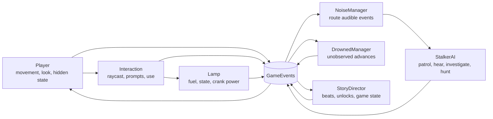
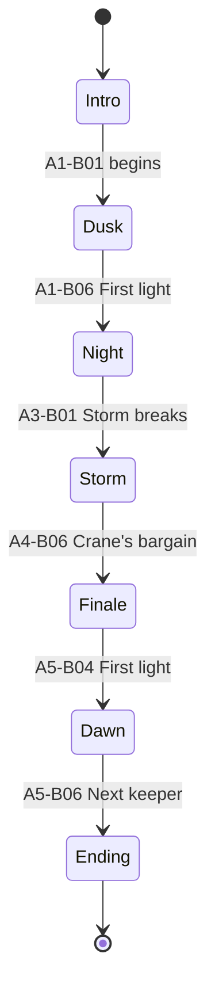

# Architecture Contract

Systems own their state and communicate through the event contracts in `events.md`. The only direct calls across systems are narrow interaction interfaces initiated by the player; lasting reactions travel through events.

## System map

## Responsibilities

| System | Owns | Does not own |
|---|---|---|
| Player | Movement, camera look, crouch, hidden state, input translation | Story progression, AI decisions, lamp state |
| Interaction | Focus detection, prompt state, invoking `IInteractable` | Target-specific outcomes |
| NoiseManager | Noise receipt, range filtering, listener notification | Producing footsteps or choosing AI behavior |
| Lamp | Fuel, illumination state, crank contribution, lamp events | Story beat completion or Drowned movement |
| StalkerAI | Navigation and sound-driven state decisions | Global noise routing or story unlocks |
| DrownedManager | Figure observation state and discrete advances | Lamp simulation or player movement |
| StoryDirector | Current game state, beat prerequisites, unlocks, dawn transition | Low-level interaction and AI locomotion |

## Game state machine

### State constraints

- `Intro`: player movement remains locked until the authored ferry handoff.
- `Dusk`: Act 1 traversal and initial lamp objective only.
- `Night`: fuel pressure, cellar, stalker, and Drowned systems may activate.
- `Storm`: generator is unavailable; the hand crank is the reliable lamp source.
- `Finale`: courtyard sequence owns pacing; optional exploration is closed.
- `Dawn`: hostile pursuit ends and the dock resolution runs.
- `Ending`: gameplay input is disabled except approved UI actions.

Save/load and pause remain deferred. Act 2 adds a checkpoint catch flow: StalkerAI publishes PlayerSpotted
then CatchRequested; CatchSequence locks the player and fades; PlayerHealthState restores the checkpoint
and publishes PlayerRespawned so Crane returns to Patrol. StoryDirector owns beat prerequisites while
GameStateMachine owns the current game state and publishes GameStateChanged.

Act 3 routes producer NoiseEmitted through NoiseManager to NoiseHeard; NoiseMasking supplies the
temporary thunder gain. Earlier scenes forward at gain 1. LampController owns charge and threshold states;
CrankStation supplies charge only while held. Storm completion is a safe placeholder within Storm,
not an early transition to Finale; the latter still requires A4-B06.

Act 4 adds LogbookJournal as the owner of collected pages and read state. Reader/Journal UI announce a
ReadingStateChanged grace window without pausing simulation. StoryDirector still owns the six canonical
revelation beats; gates consume page and beat events rather than discovering the journal. RadioSignalTracker
computes tuning and distance presentation, while its signals unlock authored story progression. Post-reveal
Crane keeps the existing sound-driven navigation and CraneHerding route bias, but replaces catch requests with
a stop/hum/retreat response after A4-B05. A4-B06 is the sole Storm-to-Finale transition.
