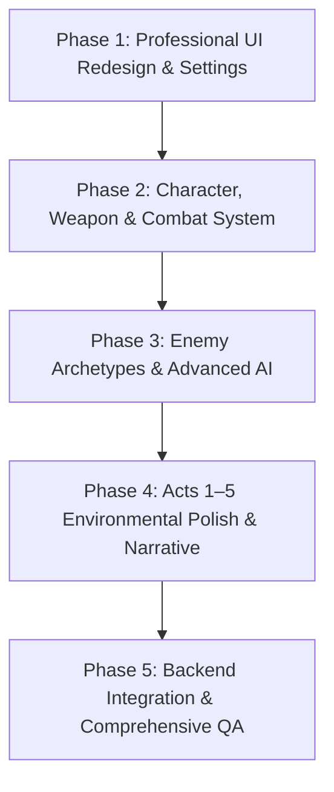

# The LightHouse — Implementation Plan

**Target Architecture:** Unity 6000.6.6f1 + Java 21 Spring Boot + PostgreSQL 16  
**Target Hardware:** MacBook Air M3 (8 GB Unified Memory)  
**Document Status:** Approved Master Plan  

---

## 1. Overview & Architectural Principles

This implementation plan outlines the prioritized execution strategy to elevate *The LightHouse* from an audited greybox slice to a polished, AAA-quality first-person psychological survival horror game.

### Core Tenets
1. **Zero Destructive Rewrites:** Existing functional code, scenes, and server endpoints are preserved and extended, never rebuilt from scratch.
2. **Event-Driven Architecture:** All gameplay systems continue to communicate through the immutable event contracts in `docs/events.md` and `GameEvents.cs`.
3. **Guaranteed Offline Fallback:** The game operates 100% locally if the Spring Boot server or PostgreSQL database is unavailable.
4. **Target Memory Budget:** All textures, geometries, lights, and audio strictly conform to the 8 GB unified memory budget in `docs/performance-budget.md`.

---

## 2. Work Breakdown & Phased Execution

---

### Phase 1: Professional UI Redesign & Complete Settings

#### 1.1 Cinematic 3D Main Menu
- **Goal:** Replace the flat 2D canvas background in `MainMenu.unity` with an atmospheric real-time 3D vignette of Harrow Rock at night.
- **Components:**
  - Real-time 3D lighthouse with sweeping rotating light beam, connected keeper's house, dark ocean waves, volumetric mist/fog, distant lightning flashes, and subtle camera drift.
  - Title typography: "THE LIGHTHOUSE", "HARROW ROCK", and tagline: "Keep the light. Never answer the singing."
  - Options list: `NEW GAME`, `CONTINUE`, `CHAPTER SELECT`, `LOAD GAME`, `SETTINGS`, `EXTRAS`, `CREDITS`, `QUIT`.
  - Confirmation modals for destructive actions (e.g., New Game overwrite warning).
- **Files Modified/Created:**
  - `Assets/_Project/Scenes/MainMenu.unity`
  - `Assets/_Project/Scripts/Editor/BuildFullGameScenes.cs`
  - `Assets/_Project/Scripts/UI/MainMenu.cs`
  - `Assets/_Project/Scripts/UI/MenuCameraController.cs`

#### 1.2 Comprehensive Settings Menu
- **Goal:** Provide a complete, fully functional, multi-tabbed settings menu that persists values across game restarts.
- **Tabs & Controls:**
  - **Display:** Resolution selector, Windowed/Fullscreen toggle, VSync toggle, Target FPS limit, Render Scale slider (0.7–1.0), Quality Presets (`Low / Mac`, `Medium`, `High`), Shadow Quality, Texture Quality.
  - **Audio:** Master Volume, Music Volume, Ambience Volume, SFX Volume, Dialogue Volume, Footsteps Volume, Horror Effects Volume.
  - **Gameplay:** Look Sensitivity (0.1–3.0), Invert Y toggle, Camera Bob toggle, Head Movement Intensity, Interaction Prompt toggle, Objective Toast toggle.
  - **Accessibility:** Subtitle toggle, Subtitle font size, Subtitle background opacity, Reduced storm flashing, Reduced camera shake.
  - **Controls / Input:** View current keyboard/mouse keybindings, Reset to default.
- **Files Modified/Created:**
  - `Assets/_Project/Scripts/UI/SettingsMenuUI.cs`
  - `Assets/_Project/Scripts/Settings/GameSettingsManager.cs`

#### 1.3 Chapter Select & Multi-Slot Save/Load
- **Goal:** Allow players to load specific unlocked acts and choose from multiple save slots (Slots 1–3).
- **Files Modified/Created:**
  - `Assets/_Project/Scripts/Core/SaveSystem.cs`
  - `Assets/_Project/Scripts/UI/ChapterSelectUI.cs`
  - `Assets/_Project/Scripts/UI/SaveLoadUI.cs`

#### 1.4 In-Game Inventory Grid & Item Inspection
- **Goal:** Upgrade `Inventory.cs` from a string list to a functional survival horror inventory grid with item icons, descriptions, weapon durability display, item combination, and quick slots.
- **Files Modified/Created:**
  - `Assets/_Project/Scripts/Interaction/Inventory.cs`
  - `Assets/_Project/Scripts/UI/InventoryGridUI.cs`
  - `Assets/_Project/Scripts/Interaction/ItemData.cs`

#### 1.5 Horror Death & Loading Interstitial Screens
- **Goal:** Replace instant checkpoint respawns with an atmospheric horror death screen (mist vignette, tragic quote, retry/load/quit buttons) and styled loading screens.
- **Files Modified/Created:**
  - `Assets/_Project/Scripts/UI/DeathScreenUI.cs`
  - `Assets/_Project/Scripts/UI/LoadingScreenUI.cs`
  - `Assets/_Project/Scripts/AI/CatchSequence.cs`

---

### Phase 2: Player Character, Rescue Axe & Combat System

#### 2.1 First-Person Arms & Visual Presentation
- **Goal:** Give Daniel Hale visible first-person arms and sleeves that move naturally during movement, sneaking, and climbing.
- **Components:**
  - First-person mesh with weathered maritime oilskin jacket sleeves and hands holding items.
  - Seamless camera parenting preventing wall clipping.
- **Files Modified/Created:**
  - `Assets/_Project/Scripts/Player/FirstPersonArms.cs`
  - `Assets/_Project/Prefabs/PlayerArms.prefab`

#### 2.2 Maritime Rescue Axe Combat
- **Goal:** Implement an axe weapon with satisfying weight, momentum, and survival horror balance.
- **Mechanics:**
  - Light swing (fast, low stamina cost, minor stagger).
  - Heavy overhead swing (charged, high stamina drain, heavy stagger).
  - Defensive block / Shove (deflects enemy grab, creates escape window).
  - Hit detection using forward spherecasts.
  - Weapon durability: blade dulls with strikes, repairable at workbenches.
- **Files Modified/Created:**
  - `Assets/_Project/Scripts/Interaction/AxeCombat.cs`
  - `Assets/_Project/Scripts/Interaction/WeaponDurability.cs`

#### 2.3 Player Numerical Health & Injury System
- **Goal:** Extend `PlayerHealthState.cs` with numerical hit points (0–100), injury penalties, bleeding, and bandage healing.
- **Mechanics:**
  - Health threshold alerts: limp movement speed reduction below 30 HP, edge blood vignette, heart thumping.
  - Bleeding: continuous slow damage until treated with cloth bandages.
- **Files Modified/Created:**
  - `Assets/_Project/Scripts/Player/PlayerHealthState.cs`
  - `Assets/_Project/Scripts/Player/PlayerInjuryEffects.cs`

---

### Phase 3: Enemy Archetypes & Advanced AI

#### 3.1 Drowned Enemy Archetypes
- **The Drifter:** Slow, waterlogged, standard patrol and investigate behavior.
- **The Listener:** Blinded by sea salt; exceptionally sensitive to player footsteps, door creaks, and axe strikes.
- **The Grasped:** Heavy drowned victim capable of grappling Daniel and battering down barricaded doors.
- **The Shallows:** Supernatural figures advancing through water when unobserved.
- **The Keeper's Shadow (Thomas Crane):** Intelligent sound stalker, herding Daniel away from the deep water, reacting to axe blows with brief retreat.
- **Files Modified/Created:**
  - `Assets/_Project/Scripts/AI/DrownedArchetype.cs`
  - `Assets/_Project/Scripts/AI/ListenerAI.cs`
  - `Assets/_Project/Scripts/AI/GraspedAI.cs`
  - `Assets/_Project/Scripts/AI/StalkerAI.cs`

---

### Phase 4: Acts 1–5 Environmental Polish & Narrative Deepening

#### 4.1 Environmental Storytelling & Visual Fidelity
- **Act 1:** Arrival at Harrow Rock, boatman warning, dock landing, muddy road, cottage kitchen and dining, warm meal, radio call.
- **Act 2:** Cellar exploration, wet footprint trails, cellar hum, first stalker sound encounter, hiding spots.
- **Act 3:** Storm outbreak, flooded generator, hand-cranking the lamp in the lantern gallery, lightning sound masking.
- **Act 4:** Logbook revelations (*Marguerite* wreckers, lighthouse leash), hidden cellar recorder, harbor board ledger, Crane's family photo.
- **Act 5:** Courtyard flooding, Crane's sacrifice and lullaby diversion, dawn escape to the morning boat.
- **Files Modified/Created:**
  - `Assets/_Project/Scripts/Editor/ReferenceVisualPass.cs`
  - `Assets/_Project/Scripts/Editor/IslandArrivalPass.cs`
  - `Assets/_Project/Scripts/Editor/LevelBuildValidation.cs`

---

### Phase 5: Backend Integration & Comprehensive QA

#### 5.1 Spring Boot Verification & New Features
- Maintain all existing contracts in `docs/websocket-messages.md` and `docs/rest-endpoints.md`.
- Verify registration, login, cloud save versioning, run tracking, WebSocket storm pressure, and telemetry.
- Expand run telemetry to record combat encounters, weapon swings, and health status.
- **Files Modified/Created:**
  - `server/src/main/java/com/thelighthouse/server/ws/WorldDirector.java`
  - `server/src/main/resources/db/migration/V4__add_combat_telemetry.sql`

#### 5.2 Quality Assurance & Performance Testing
- Run Maven test suite (`cd server && mvn test`) — 100% passing tests.
- Run Unity build validation (`LevelBuildValidation.ValidateBatch()`) — 0 errors across Acts 1–5.
- Profile memory allocations, draw calls, and frame rates to ensure sustained 30–60 FPS on MacBook Air M3.

---

## 3. Risk Assessment & Mitigation

| Technical Risk | Likelihood | Impact | Mitigation Strategy |
|---|---|---|---|
| **Scene YAML Corruption** | High | Severe | Never edit `.unity` YAML files directly. Author all level changes through automated procedural C# Editor scripts. |
| **8 GB Unified Memory OOM** | Moderate | Severe | Enforce 1K texture caps, bake static lighting, pool particle systems, and unload unused assets on act transitions. |
| **Breaking Save Compatibility** | Low | High | Use backward-compatible JSON fields with fallback defaults in `GameSaveData`. |
| **Network Thread Desync** | Low | High | Route all server and WebSocket callbacks across `MainThreadDispatcher.cs` before altering Unity state. |

---

## 4. Testing Strategy

1. **Unit & Integration Tests:**
   - Spring Boot: `CloudSaveIntegrationTest`, `BackendThinSliceIntegrationTest`, `WorldDirectorTest`.
   - Unity: `LevelBuildValidation.ValidateBatch()`, Play Mode smoke tests.
2. **Interactive UI Verification:**
   - Verify every slider, toggle, and button across MainMenu, Settings, PauseMenu, Inventory, and Journal.
3. **Gameplay Loop Verification:**
   - End-to-end traversal from MainMenu through Acts 1–5 to the morning boat ending.
