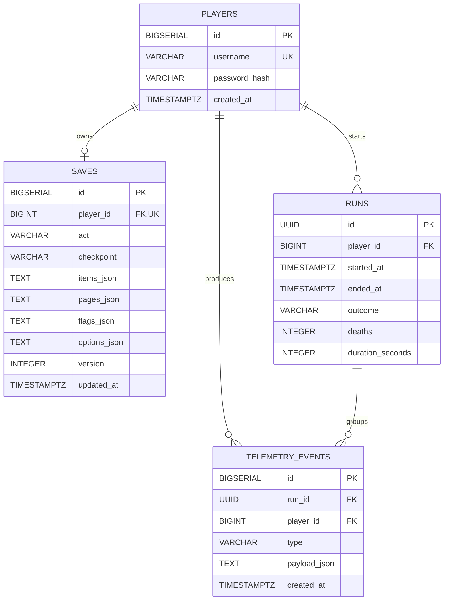

# Database ER diagram

The schema is created by `V1__create_players.sql`,
`V2__create_saves_and_runs.sql`, and `V3__create_telemetry_events.sql`.

`TelemetryService` currently creates telemetry rows with `run_id = NULL`; the
foreign key is present but no active-run lookup is implemented.
