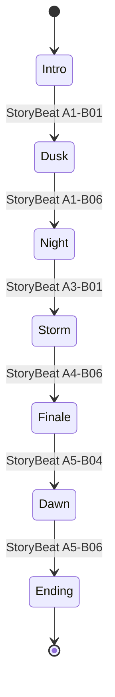
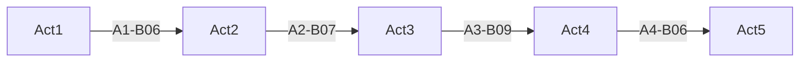

# Game state and act flow

`GameStateMachine` owns these runtime states and transitions. When
`ActFlowController.enableSceneChaining` is true, the scene flow is:

The full-game transition loads the next scene additively, makes it active,
unloads the previous scene, unloads unused assets, and restores `SaveSystem`
state. Direct act test scenes can start at configured later states.
