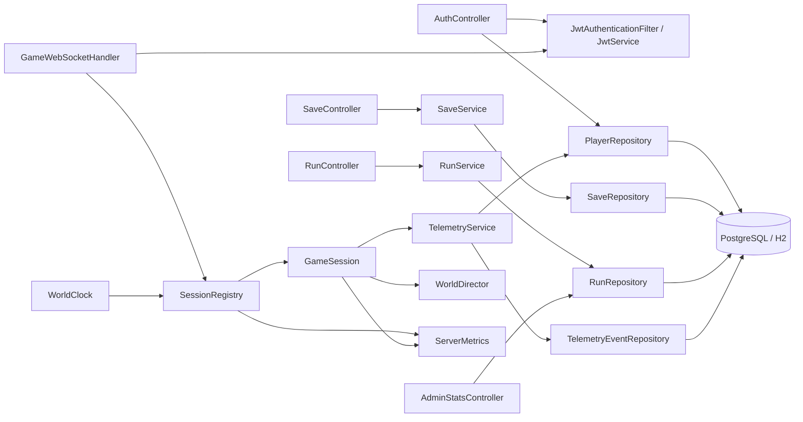

# Server components

Classes are in `server/src/main/java/com/thelighthouse/server/`. Spring MVC
controllers receive HTTP requests. `GameWebSocketHandler` authenticates and
routes frames to `SessionRegistry`; `WorldClock` calls each
[`GameSession`](../../server/src/main/java/com/thelighthouse/server/ws/GameSession.java)'s
tick. `WorldDirector` owns per-session gameplay state. `TelemetryService` is
the asynchronous database writer.
