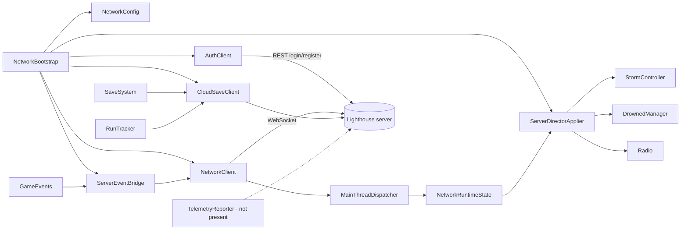

# Unity network layer

`NetworkBootstrap` creates the persistent runtime objects when a
`NetworkConfig` asset is enabled. `AuthClient` obtains a JWT. `NetworkClient`
connects, sends client envelopes, receives server envelopes, and queues parsing
on `MainThreadDispatcher`. `ServerEventBridge` translates selected
`GameEvents` into outbound messages. `ServerDirectorApplier` applies
`STORM_STATE`, `PRESSURE_DELTA`, `RADIO_MESSAGE`, and selected narrative messages
to local systems. `CloudSaveClient` calls `/save` and `/runs`; `SaveSystem`
continues to write the local JSON save first.

There is no `TelemetryReporter` class or Unity telemetry endpoint in the current
repository. Telemetry is generated on the Java server from accepted WebSocket
messages.
